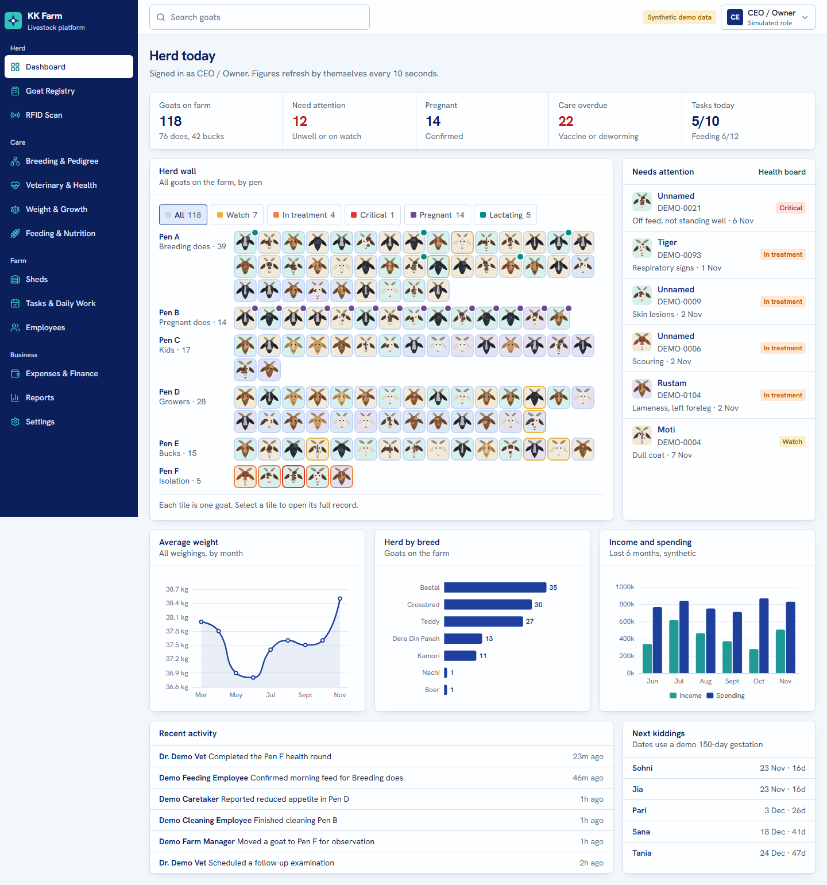
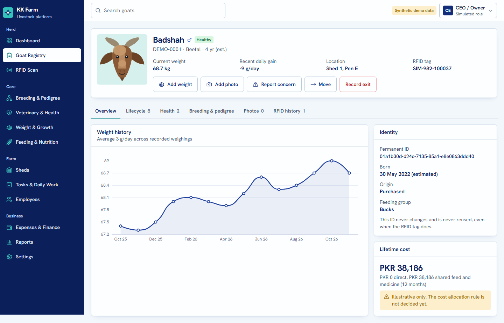
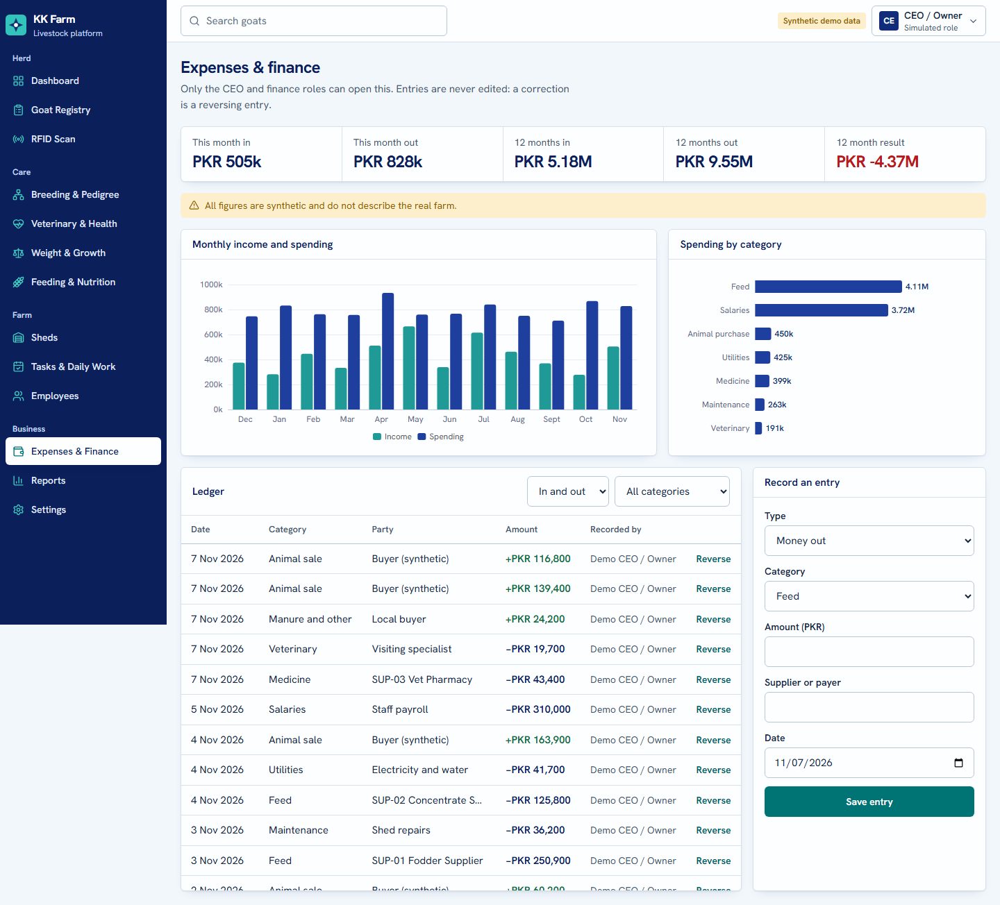
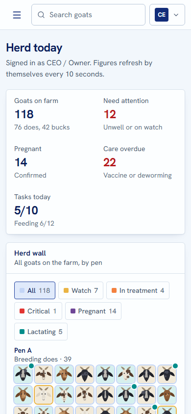

# KK Farm — local preview

The first working version of KK Farm, running on the owner's laptop only. **All data is synthetic.** The RFID reader is simulated, sign-in is simulated, and nothing here is deployed or exposed publicly. This is a prototype (D-036), not a production implementation: farm rules are still unconfirmed until the farm visit.

**Open it:** http://127.0.0.1:8000

## Restart

```powershell
powershell -ExecutionPolicy Bypass -File "C:\Users\AMMAR\Desktop\KK Farm\apps\kk-farm\start-local.ps1"
```

This starts the database container if needed and serves the app. If it is already running, the script says so.

## First-time setup on another machine

Needs PHP 8.4+ with `pdo_pgsql`, Composer, Node 22+, and Docker.

```powershell
docker run -d --name kkfarm_local_db --restart unless-stopped -e POSTGRES_USER=kkfarm -e POSTGRES_PASSWORD=<choose-one> -e POSTGRES_DB=kkfarm -p 127.0.0.1:5442:5432 -v kkfarm_local_pgdata:/var/lib/postgresql postgres:18
docker exec kkfarm_local_db psql -U kkfarm -d kkfarm -c "create database kkfarm_test"
composer install
npm install
copy .env.example .env   # then set DB_PASSWORD to the value chosen above
php artisan key:generate
php artisan migrate:fresh --seed
npm run build
```

## Reset the demo data

```powershell
php artisan migrate:fresh --seed
```

## Where things live

| What | Where |
|------|-------|
| Source code | This folder, branch `prototype/kk-farm-local-preview` |
| Database | Docker volume `kkfarm_local_pgdata`, container `kkfarm_local_db`, port 5442 on localhost only |
| Uploaded photos | `storage/app/private/animals/<goat id>/` (not in Git) |
| Local settings | `.env` (not in Git) |
| Business rules | `app/Support/Farm.php`, `config/kkfarm.php` |
| Demo data | `database/seeders/DatabaseSeeder.php` |
| Design system | `resources/css/app.css`, `resources/js/components/ui.tsx`, `/DESIGN.md` |

## Tests

```powershell
php artisan test        # 17 tests of the critical business rules, on PostgreSQL
npm run typecheck       # TypeScript
npm run test:e2e        # browser test; the app must be running, and it adds demo records
```

## Technology used

| Approved (D-023) | In this preview |
|------------------|-----------------|
| Laravel 13 | Laravel 13 |
| PHP 8.5 | **PHP 8.4**, the version on this laptop. Laravel 13 supports it. |
| Inertia 3, React 19, TypeScript 7, Vite 8, Tailwind 4 | As approved |
| PostgreSQL 18 | PostgreSQL 18.6 in Docker |
| Motion, ECharts | As approved |
| Octane | **Not used.** `php artisan serve`, a single-process development server. |
| Reverb (WebSockets) | **Not used.** The dashboard polls every 10 seconds instead. |
| Valkey, Horizon | **Not used.** Database cache and sessions; no background workers needed yet. |
| Garage, imgproxy | **Not used.** Photos are stored as uploaded on local disk, with no resizing or WebP/AVIF variants. |
| shadcn/ui, TanStack, D3 | **Not used.** Small custom components instead. |

## Known limits

- Sign-in is a role picker with no passwords. It is refused outside the local and testing environments.
- Real-time is polling, so updates take up to 10 seconds, not under a second.
- Reachable only from this laptop. A real phone cannot open `127.0.0.1`; mobile layouts were tested with phone emulation.
- No offline mode, no Urdu, no AI features.
- Pen layout, feeding groups, rations, vaccines, the 150-day gestation and lifetime cost are placeholders until the farm visit confirms them.
- Goat pictures are generated illustrations until real photos are uploaded.
- Charts add about 197 kB (gzip) on the pages that use them, above the proposed budget.

## Screenshots

Synthetic data.








