# Domain Model

**Status:** Draft v0.1 — derived from the project brief. To be revised after the farm visit and workbook analysis.

This document describes the *things* KK Farm manages and how they relate, in language a vet or farm manager can check. The database tables that implement it are in [DATABASE_DESIGN_DRAFT.md](DATABASE_DESIGN_DRAFT.md).

## 1. Core principles

1. **The animal is the centre.** Every record ultimately hangs off an `Animal`.
2. **Identity ≠ tag.** `Animal.id` is permanent and never reused. An RFID tag is a physical object with its own history; it is *assigned to* an animal for a period of time. `[CONFIRMED]`
3. **History is never deleted.** Leaving the farm, replacing a tag, moving sheds, correcting a mistake — all are *new events*, not edits or deletions. `[CONFIRMED]`
4. **Every fact has an author and a time.** Who observed/recorded it, when it happened, when it was entered (these can differ, e.g. offline entry).
5. **Professional accountability.** Medical and feeding decisions are attributable to a named, authorised person.
6. **Groups are derived, not primary.** Feeding groups and pens are assignments over time; the animal's record is the truth.

## 2. Entity overview

```mermaid
erDiagram
    ANIMAL ||--o{ RFID_ASSIGNMENT : "has history of"
    RFID_TAG ||--o{ RFID_ASSIGNMENT : "assigned via"
    BREED ||--o{ ANIMAL : "classifies"
    ANIMAL ||--o{ ANIMAL : "sire / dam of"
    ANIMAL ||--o{ LOCATION_ASSIGNMENT : "lives in (over time)"
    PEN ||--o{ LOCATION_ASSIGNMENT : ""
    SHED ||--o{ PEN : "contains"
    ANIMAL ||--o{ ANIMAL_EVENT : "lifecycle timeline"
    ANIMAL ||--o{ WEIGHT_RECORD : ""
    ANIMAL ||--o{ HEALTH_OBSERVATION : ""
    ANIMAL ||--o{ EXAMINATION : ""
    EXAMINATION ||--o{ DIAGNOSIS : ""
    EXAMINATION ||--o{ TREATMENT : "prescribes"
    TREATMENT ||--o{ MEDICINE_ADMINISTRATION : "fulfilled by"
    MEDICINE ||--o{ MEDICINE_ADMINISTRATION : ""
    ANIMAL ||--o{ PREVENTIVE_CARE_RECORD : "vaccination / deworming"
    ANIMAL ||--o{ HEAT_OBSERVATION : "(females)"
    ANIMAL ||--o{ MATING_EVENT : "as dam"
    ANIMAL ||--o{ MATING_EVENT : "as sire"
    MATING_EVENT ||--o{ PREGNANCY_CHECK : ""
    MATING_EVENT ||--o| KIDDING_EVENT : "results in"
    KIDDING_EVENT ||--o{ ANIMAL : "produces kids"
    FEEDING_GROUP ||--o{ FEEDING_GROUP_MEMBERSHIP : ""
    ANIMAL ||--o{ FEEDING_GROUP_MEMBERSHIP : ""
    FEEDING_PLAN ||--o{ FEEDING_GROUP : "applies to"
    FEEDING_PLAN ||--o{ FEEDING_PLAN_APPROVAL : "approved by vet"
    FEEDING_GROUP ||--o{ FEEDING_COMPLIANCE_LOG : ""
    USER ||--o{ ROLE_ASSIGNMENT : ""
    USER ||--o{ TASK : "assigned"
    SUPPLIER ||--o{ EXPENSE : ""
    EXPENSE ||--o{ EXPENSE_ALLOCATION : "to animal / shed"
    ANIMAL ||--o{ ANIMAL_TRANSACTION : "purchase / sale"
    USER ||--o{ AUDIT_LOG : "performed"
```



## 3. Entities

### 3.1 Identity & classification

| Entity | What it is | Key attributes | Notes |
|--------|------------|----------------|-------|
| **Animal** | One goat, for its whole life and after. | `id` (immutable), `farm_number` (human-readable, `[ASSUMED]`), `name` (optional), `sex` (M/F), `reproductive_status` (intact / castrated / spayed — `[ASSUMED]`), `breed_id`, `birth_date` **or** `estimated_birth_date` + `age_estimation_method`, `origin` (born / purchased), `sire_id`, `dam_id` (nullable), `status` (active / left-farm / deceased), `exit_reason`, `exit_date` | Never deleted. Status changes are events. |
| **Breed** | A breed definition. | `name`, `description`, `default_gestation_days` (`[ASSUMED]`) | Dynamically managed. Cross-breeds: `[UNKNOWN]` → Q-PB-4. |
| **RFID Tag** | The physical tag. | `epc` / `tag_code`, `tag_type` (LF/UHF), `printed_number`, `status` (in stock / assigned / lost / destroyed) | Can be reused. `epc` is unique per tag but is **not** the animal key. |
| **RFID Assignment** | Period during which a tag identified an animal. | `animal_id`, `tag_id`, `assigned_at`, `assigned_by`, `unassigned_at`, `unassigned_by`, `reason` | Exactly one *open* assignment per tag, and at most one per animal, at any moment. |
| **Animal Photo** | Image of the animal. | `animal_id`, `taken_at`, `file` | `[ASSUMED]` |

### 3.2 Location

| Entity | What it is | Key attributes |
|--------|------------|----------------|
| **Shed** | A building. | `name`, `code`, `status` (planned / active / closed) |
| **Pen** | A subdivision of a shed. `[ASSUMED]` | `shed_id`, `name`, `capacity` |
| **Location Assignment** | Where an animal was, and when. | `animal_id`, `pen_id`, `from`, `to`, `moved_by`, `reason` |

A *transfer* = close the current assignment + open a new one, recorded as one event.

### 3.3 Lifecycle timeline

| Entity | What it is |
|--------|------------|
| **Animal Event** | A unified, append-only timeline entry: born, registered, purchased, tag assigned/removed, moved, weighed, examined, treated, vaccinated, mated, pregnancy-checked, kidded, fed-specially, sold, gifted, sacrificed, died, note. Each points to the detailed record where one exists. |

This gives "complete lifecycle history" (AM-11) as one screen per goat without joining twenty tables in the UI.

### 3.4 Weight

| Entity | Key attributes |
|--------|----------------|
| **Weight Record** | `animal_id`, `measured_at`, `weight_kg`, `method` (scale / estimate / tape), `measured_by`, `context` (routine / pre-sale / post-illness / birth / weaning) |

Derived (not stored): ADG between any two records; growth curve vs. peers.

### 3.5 Veterinary

| Entity | What it is | Key attributes |
|--------|------------|----------------|
| **Health Observation** | A concern or routine observation by anyone (caretaker, vet). | `animal_id` (or `pen_id` for group observations), `observed_at`, `observed_by`, `symptoms[]`, `severity`, `notes`, `photo` |
| **Examination** | A vet's formal examination. | `animal_id`, `vet_id`, `examined_at`, `triggered_by` (observation / schedule / alert / follow-up), `findings`, `temperature`, `body_condition_score`, `next_follow_up_at` |
| **Diagnosis** | A condition identified at an examination. | `examination_id`, `condition` (from vocabulary or free text — Q-VT-8), `certainty`, `notes` |
| **Treatment** | A prescribed course. | `examination_id`, `prescribed_by` (vet only), `medicine_id`, `dose`, `route`, `frequency`, `start`, `end`, `withdrawal_until` (`[ASSUMED]`) |
| **Medicine Administration** | A dose actually given. | `treatment_id`, `given_at`, `given_by`, `dose_given`, `notes` |
| **Medicine** | Catalogue of drugs. | `name`, `unit`, `default_withdrawal_days`, `requires_vet` |
| **Preventive Care Record** | Vaccination / deworming / hoof-trim etc. | `animal_id`, `type`, `product`, `given_at`, `given_by`, `next_due_at` |
| **Preventive Care Schedule** | Rule: e.g. "PPR vaccine at 4 months, booster yearly". | `type`, `applies_to` (breed/age/sex), `interval` |
| **Health Alert** | Something needing attention. | `animal_id`, `type`, `severity`, `source` (rule / vet / observation), `raised_at`, `acknowledged_by`, `resolved_at` |

**Accountability rule:** `Diagnosis` and `Treatment` can only be created by a user with the Veterinarian role. `Health Observation` can be created by anyone with animal access. `[ASSUMED]` → Q-VT-1.

### 3.6 Breeding

| Entity | Key attributes |
|--------|----------------|
| **Heat Observation** | `animal_id` (female), `observed_at`, `observed_by`, `signs[]`, `intensity` |
| **Mating Event** | `dam_id`, `sire_id` (nullable if unknown / group), `mated_at`, `method` (natural / AI), `mating_type` (controlled / group — `[ASSUMED]`), `recorded_by`, `expected_kidding_at` (derived from breed gestation) |
| **Pregnancy Check** | `mating_event_id`, `checked_at`, `checked_by` (vet), `method`, `result` (pregnant / not / inconclusive), `fetus_count_estimate` |
| **Kidding Event** | `mating_event_id` (nullable if unknown), `dam_id`, `kidded_at`, `attended_by`, `difficulty`, `total_born`, `born_alive`, `stillborn`, `notes` |
| **Kid registration** | Each live kid becomes an `Animal` with `origin = born`, `sire_id`, `dam_id`, `kidding_event_id`, `birth_weight` (as first Weight Record). |

Derived: breeding performance per doe (conception rate, kiddings/year, kids weaned) and per buck (conceptions, offspring ADG).

### 3.7 Nutrition & feeding

| Entity | Key attributes |
|--------|----------------|
| **Feeding Group** | `name`, `pen_id` (optional), `criteria` (age range, sex, pregnancy, lactation, weight range, health flag), `status` |
| **Feeding Group Membership** | `animal_id`, `group_id`, `from`, `to`, `assigned_by`, `reason` (rule / manual) |
| **Feeding Plan** | `group_id` **or** `animal_id` (individual plan), `version`, `items[]` (feed item, quantity, times per day), `effective_from`, `status` (draft / pending approval / approved / superseded) |
| **Feeding Plan Approval** | `plan_id`, `approved_by` (vet/nutritionist), `approved_at`, `comment` |
| **Feeding Compliance Log** | `group_id`, `plan_id`, `fed_at`, `fed_by`, `session` (morning / evening), `status` (done / partial / missed), `notes` |
| **Feed Item** | `name`, `unit`, `category` (fodder / concentrate / mineral / water additive) |

**Rule:** A plan is not *active* until approved (NF-4). Group membership suggestions come from criteria; a human confirms.

### 3.8 Farm operations

| Entity | Key attributes |
|--------|----------------|
| **User** | `name`, `phone`, `login`, `language`, `active` |
| **Role Assignment** | `user_id`, `role`, `granted_by`, `from`, `to` |
| **Task** | `type` (feeding / cleaning / observation / weighing / custom), `target` (pen / group / animal), `assigned_to`, `due_at`, `status`, `completed_at`, `completed_by`, `evidence` (photo/notes) |
| **Daily Assignment** | A generated or manual set of tasks per user per day. |
| **Activity Log** | Operational history (who did what on the farm) — distinct from the technical audit log. |

### 3.9 Finance

| Entity | Key attributes |
|--------|----------------|
| **Supplier** | `name`, `type` (feed / medicine / vet / utility / livestock / other), `contact` |
| **Expense** | `category`, `supplier_id`, `amount`, `currency`, `incurred_at`, `description`, `attachment` (bill/receipt), `recorded_by`, `status` |
| **Expense Allocation** | `expense_id`, `target_type` (animal / shed / group / farm), `target_id`, `share` — allows a feed bill to be spread across animals or sheds |
| **Payment** | `direction` (in / out), `amount`, `method`, `paid_at`, `counterparty`, `reference`, `linked_to` (expense / animal transaction / other), `recorded_by` |
| **Animal Transaction** | `animal_id`, `type` (purchase / sale / gift-out / gift-in / sacrifice), `counterparty`, `amount`, `date`, `documents` |
| **Audit Log** | Immutable: `actor`, `action`, `entity`, `before`, `after`, `at`, `ip/device`. Every financial, medical and identity change is logged. |

**Rule:** Financial records are append-only; a mistake is corrected by a reversing entry. `[ASSUMED]` → Q-FN-3.

## 4. Lifecycle states

### Animal
```
registered ──► active ──► left-farm (sold | gifted | sacrificed | transferred-out)
                 │
                 └──► deceased
```
Every transition is an `Animal Event`; records remain fully readable in every state. A left-farm/deceased animal cannot receive new weights, treatments or matings (validation), but can still receive *historical* corrections as new dated events.

### RFID tag
```
in-stock ──► assigned ──► (unassigned) ──► in-stock | lost | destroyed
```

### Feeding plan
```
draft ──► pending-approval ──► approved ──► superseded
                 └──► rejected
```

### Breeding cycle (per mating)
```
heat observed ──► mated ──► pregnancy check ──► pregnant ──► kidded
                                   └──► not pregnant (cycle closed)
```

## 5. Key invariants (what the system must never allow)

| # | Invariant |
|---|-----------|
| I-1 | `Animal.id` is never changed or reused. |
| I-2 | At any instant a tag identifies at most one animal, and an animal carries at most one open RFID assignment. |
| I-3 | No record of an animal is ever hard-deleted. |
| I-4 | A `Treatment` or `Diagnosis` always has a vet as author. |
| I-5 | A `Feeding Plan` affects feeding only after approval by an authorised approver. |
| I-6 | Financial entries are never edited after posting; corrections are new entries. |
| I-7 | An animal cannot be its own ancestor (pedigree is a DAG). |
| I-8 | Kids registered from a kidding event inherit `dam_id` from the event; `sire_id` comes from the linked mating event or is explicitly marked unknown. |
| I-9 | Every write records *who* and *when*. |

## 6. What the workbook and farm visit must still tell us

- Whether pens exist and how animals are grouped physically (3.2).
- Whether milk/lactation records are needed (would add `Lactation` and `Milk Record`).
- The actual vocabulary for symptoms, diagnoses, feed items and exit reasons.
- Whether group mating exists (affects `Mating Event.sire_id` certainty).
- How costs should be allocated to animals (3.9 `Expense Allocation`).
